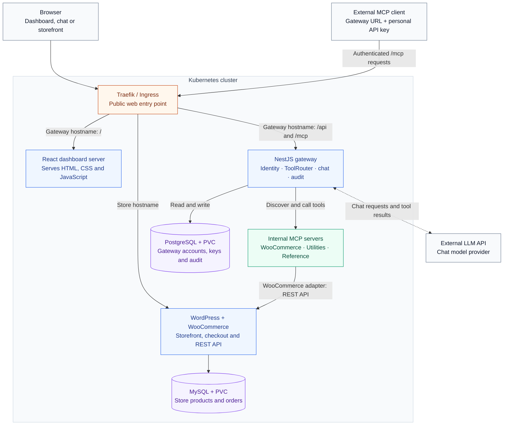
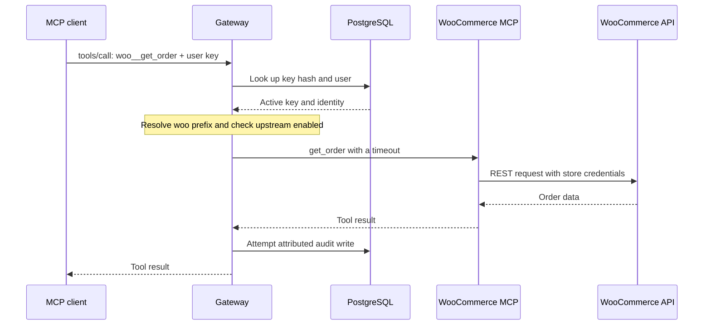

# Team MCP Gateway on Kubernetes

A WooCommerce store, a self-written store MCP adapter, a team gateway, a React
dashboard and an LLM chat agent. Admins connect upstream servers once; members
use their tools through one gateway endpoint with their own identity.

## Architecture



**How to read it:** browsers and MCP clients enter through Traefik. The gateway
authenticates tool users and routes calls to internal MCP servers. Only the
WooCommerce adapter calls the store API; utilities and reference tools do not.
The model provider sits outside the cluster.

- **Dashboard:** the server supplies static assets; React executes in the browser
  and calls the gateway API. The dashboard server does not execute the chat model.
- **Chat and external tools:** both use the gateway's shared ToolRouter and user
  attribution. External clients need a gateway key, not upstream credentials.
- **Checkout:** customer purchases go directly to WooCommerce through Ingress,
  bypassing the gateway and MCP adapter.
- **State:** PostgreSQL holds gateway records; MySQL holds store records.
  WordPress uploads also use a persistent volume, omitted from this overview.

<details>
<summary><strong>Trace one MCP request: retrieve an order</strong></summary>



The client's key stops at the gateway. The adapter uses separate server-side
WooCommerce credentials. Audit persistence failures are logged; the current
implementation does not guarantee durable audit capture during database failure.

</details>

### Deployment boundaries

| Namespace | Workloads |
| --- | --- |
| `kube-system` | Traefik and Kubernetes supporting services |
| `urumi-platform` | Dashboard, gateway, PostgreSQL and three MCP servers |
| `urumi` | WordPress/WooCommerce, MySQL and the store setup Job |

All application workloads run in the cluster. Local k3d hosts K3s inside Docker;
Azure runs K3s directly on an Ubuntu VM using containerd. The cloud demo uses one
VM; it is not a highly available or managed AKS deployment.

### Repository layout

| Path | Responsibility |
| --- | --- |
| `apps/dashboard/` | React, TypeScript and Vite frontend |
| `apps/gateway/` | NestJS API, MCP endpoint, identity, routing, chat and audit |
| `apps/woocommerce-mcp/` | Custom adapter with five store tools |
| `apps/utils-mcp/` | Helper tools; currency rates are fixed demo values |
| `apps/everything-mcp/` | Pinned MCP reference server |
| `charts/store/` | WordPress, MySQL, storage, Ingress and setup Job |
| `charts/platform/` | Gateway, dashboard, PostgreSQL, MCP and network policies |
| `scripts/` | Local setup and Azure deployment automation |

This is a monorepo with separate app build contexts and a modular gateway.
Personal study guides, illustrations and generated PDFs are kept local-only.

## Local setup

Use Windows PowerShell with Docker Desktop's Linux engine running, `kubectl`, and
Node.js 22.13 or newer for development/tests. The scripts download pinned,
checksum-verified k3d and Helm into ignored `.local/`.

```powershell
.\scripts\install-local-tools.ps1
.\scripts\create-local-cluster.ps1
.\scripts\deploy-store-foundation.ps1
.\scripts\deploy-platform.ps1
```

The cluster script starts the existing `urumi` cluster instead of replacing it.
The store setup Job configures WordPress/WooCommerce and cash on delivery. The
platform script builds five images, imports them and installs a Helm release.

The domain approach is `*.localhost` with loopback host ports 8080 (HTTP), 8443
(HTTPS when configured) and 6550 (Kubernetes API):

- Dashboard: <http://gateway.localhost:8080>, email `admin@urumi.local` and
  `ADMIN_PASSWORD` from ignored `.local/platform-secrets.env`.
- Shop: <http://store.localhost:8080/shop/>.
- Store admin: <http://store.localhost:8080/wp-admin/>, with `STORE_ADMIN_USER`
  and `STORE_ADMIN_PASSWORD` from the same file.
- External MCP: `http://127.0.0.1:8080/mcp`, avoiding Windows client differences
  in resolving `*.localhost`.

Generated secrets are reused. Do not delete them to rotate initialized database
passwords or encryption keys. Local and cloud accounts/data are independent.

### Chat and order walkthrough

Chat supports an OpenAI-compatible tool-calling API. The default chart uses Groq
with `openai/gpt-oss-120b`; provider/model/base URL are configurable through values.
Supply your provider key privately and restart the gateway:

```powershell
.\scripts\create-local-secrets.ps1 -LlmApiKey '<your API key>'
kubectl --kubeconfig .local\kubeconfig -n urumi-platform rollout restart deployment gateway
```

1. Prepare a labelled demo product through WordPress or chat. Do not assume an
   old product name/order ID exists in a fresh store.
2. Add it to the cart in the storefront and check out with cash on delivery and
   synthetic customer details. Verify the actual order in WooCommerce > Orders.
3. As User A, ask chat to create another product with a name and price, confirm
   the action, inspect the tool trace and verify it appears in the shop.
4. Place an order for that product **through the storefront by hand**. Ask chat
   what orders arrived today and verify that order is returned.
5. Inspect the audit log for the correct user, tool, source and outcome.

Chat uses the logged-in user's identity and the shared ToolRouter. Prompt-level
write confirmation is not an enforced backend approval gate. Keep real credentials
and authorization headers out of screen recordings and shared shell histories.

## External MCP client and User B

An admin invites User B in **Members**. Open the generated one-time link to accept;
outbound invitation email is not configured. B creates a personal key in **API
keys**. Its full value is shown once. A Streamable HTTP client needs only the
gateway URL and B's key; adapt this example to the client's supported format:

```json
{
  "mcpServers": {
    "urumi": {
      "type": "http",
      "url": "http://127.0.0.1:8080/mcp",
      "headers": { "Authorization": "Bearer <USER_B_GATEWAY_KEY>" }
    }
  }
}
```

For cloud access use the public HTTPS `/mcp` URL. Do not supply store/database
credentials to the client. Discover tools, retrieve the same orders and run one
prompt using WooCommerce plus utilities, for example converting an order total
using the fixed demonstration rates.

## VPS / production-like setup

The same store/platform chart templates run locally and on Linux K3s. Environment
differences are values: DNS/public URL, image tags, storage class, admin identity
and TLS/Ingress settings. Secrets are provisioned separately and referenced by name.

The [Azure operational runbook](scripts/azure/README.md) describes the deployed VM
path; `scripts/azure/main.bicep` declares infrastructure and `cloud-init.yaml`
installs K3s and Helm during first boot:

1. Provision an appropriately sized Ubuntu VM and network. Restrict SSH to the
   administrator; expose HTTP/HTTPS, not database or upstream ports.
2. Wait for cloud-init/K3s readiness and verify the SSH host key through the provider.
3. Run `scripts/azure/package-release.ps1` to build/export images and charts.
   Transfer archives over SSH, extract the release to `/opt/urumi/release`, then
   import images with `sudo k3s ctr images import /path/to/images.tar`.
4. Run the server script with the image tag, resolving hostnames and admin email:

```bash
sudo bash /opt/urumi/release/scripts/azure/deploy-on-vm.sh \
  IMAGE_TAG gateway.example.com store.example.com admin@example.com
```

The script generates/reuses cloud Secrets, sets local-path storage, configures
Traefik ACME and installs both releases. DNS must resolve to the VM; HTTP-01 needs
port 80 reachable. The optional root-readable `llm.env` contains only the model
API key. This workflow imports images directly and does not require a registry.

For another host/registry, adapt the examples in each chart's `values-prod.yaml`,
create the namespaces/Secrets and TLS configuration, then deploy:

```bash
helm upgrade --install store charts/store -n urumi \
  -f charts/store/values-prod.yaml --wait
helm upgrade --install platform charts/platform -n urumi-platform \
  -f charts/platform/values-prod.yaml --wait
```

The examples contain placeholders, not ready-to-use credentials. The Azure demo
uses a single VM with public HTTPS and local-path volumes. Internal service traffic
uses HTTP with network access controls, not end-to-end TLS. Backups, tested restore,
custom domain and high availability remain follow-up work. Running VM compute
consumes credits even without visitors. Deallocation stops on-demand compute
billing; retained resources can still cost money. Coordinate reviewer availability.

## System design and tradeoffs

### Tool aggregation, collisions and routing

The gateway is an MCP server to clients and an MCP client to each upstream.
Each tool is prefixed with its stable upstream slug: `<slug>__<tool>`, such as
`woo__get_order` or `utils__echo`. This handles cross-server collisions; unsupported
or oversized tool names are excluded and reported in the server view.

The shared ToolRouter resolves the prefix, checks the upstream is enabled, and
calls its MCP client. Chat uses this same routing path. The custom store adapter
maps `list_products`, `create_product`, `list_orders`, `get_order` and
`update_order_status` to WooCommerce REST APIs. REST keeps authentication and
store business rules in WooCommerce rather than coupling to its database schema.

### Slow or dead upstreams

Discovery/status checks and calls have timeouts (defaults: 5 seconds for listing,
15 seconds for calls). Per-upstream snapshots and connections contain failures;
healthy servers remain usable. Uncached aggregate discovery may still wait for a
slow server's deadline. Failed calls return errors and can refresh status/client
connections. Disabling an upstream removes its tools and rejects direct calls.

A timed-out write may already have committed in the store. Inspect before retrying;
automatic idempotent reconciliation is not implemented. Status/client state is
in memory. Multi-replica behavior and coordinated caching are not demonstrated.

### Persistence, upgrades and rollback

PostgreSQL owns gateway data; MySQL owns store data. WordPress files and database
files have PVCs. Preserve the encryption key and secret configuration. Helm deploys
versioned images; probes and resource requests/limits are declared in the charts.

```powershell
.local\tools\helm.exe --kubeconfig .local\kubeconfig -n urumi-platform history platform
.local\tools\helm.exe --kubeconfig .local\kubeconfig -n urumi-platform rollback platform <revision>
```

On the VM use Helm with `/etc/rancher/k3s/k3s.yaml`. Rollback changes manifests/images,
not stored data. Check migration compatibility before rolling back. Back up database
exports, WordPress uploads and the encryption key outside the VM; a PVC is not a backup.

## Threat model

### Shared upstream credentials and client tokens

Members never receive upstream secrets, but can exercise the capabilities of
enabled tools through the gateway. Roles protect administration; per-tool read/write
permissions are not implemented. Shared upstream credentials can therefore confer
substantial indirect power. Use least-privilege service credentials.

Client session/API tokens stop at the gateway. Upstream requests use the configured
service credential, not the caller's token. Passwords use salted scrypt hashes;
gateway keys, sessions and invites are hashed. Recoverable upstream credentials
use AES-256-GCM with a separate key. The API exposes whether a credential is set,
not its value.

### Malicious upstreams, model manipulation and SSRF

Tool descriptions/results can contain prompt injection or sensitive data. The
chat prompt treats them as data, but instructions alone are not a security boundary.
A compromised model can request any tool operation the user is permitted to run.
Validation and authorization remain server-side; the external model receives
conversation/tool data across a trust boundary.

Admin URLs are checked for schemes, embedded credentials and blocked/private/
metadata addresses unless deliberately allowlisted. Redirects are refused; checks
recur when connecting. Intended internal cluster hosts require explicit allowlisting.
These controls reduce exposure; they are not proof that every SSRF/DNS threat is solved.

### What members can do to one another

Admin endpoints enforce roles server-side. Members manage their own keys and view
their own audit history; admins manage people/servers and see team records. This
is one team workspace, not isolated multi-tenant SaaS. Revocation rejects the next
authenticated request; it does not cancel an already running operation.

Members with access to write tools can change shared store records and thereby
affect other members' work. The current model does not isolate stores or enforce
per-tool read-only roles. Hiding another user's keys does not isolate shared data.

Platform NetworkPolicies default-deny ingress and allow selected Traefik access,
gateway-to-upstream access and gateway-to-PostgreSQL access. There is no public
adapter route; the Woo adapter also uses a service bearer token. Test enforcement
on the actual cluster. Ingress restrictions are not default-deny egress or TLS;
privileged cluster operators can change policies and labels.

### Remaining risks and limits

- Normal-path audit records include user, server, tool, timestamp, duration, source
  and outcome. AuditService catches persistence failures rather than failing an
  already executed action. Guaranteed durable audit during database failure is absent.
- No per-key rate limiting, OAuth, per-tool permissions, multi-store provisioning
  or verified multi-replica operation.
- The reference server exposes broad demo tools; avoid giving it secrets and
  disable unnecessary capabilities before using real data.
- Browser bearer sessions make XSS consequential. Do not render untrusted HTML.
- Kubernetes Secrets do not imply encryption at rest. Host controls, rotation and
  recovery procedures still require deliberate operation.

## Checks and acceptance demo

```powershell
npm.cmd run install:apps
npm.cmd run typecheck
npm.cmd test
npm.cmd run build
kubectl --kubeconfig .local\kubeconfig get pods,svc,ingress,pvc -A
```

Rehearse the brief's full two-user flow in the environment being recorded:

1. Storefront checkout and matching order in WooCommerce admin.
2. User A creates a product through chat; it appears in the storefront.
3. A manual storefront order for that product is returned by today's-orders chat.
4. User B connects using only the gateway URL and B's key, discovers enabled tools,
   asks the same orders question, and runs one prompt using two upstreams.
5. Revoke B's temporary key; its next request is rejected.
6. Disable an upstream; tools disappear from chat and refreshed external discovery.
7. Kill a selected upstream Pod; observe status while another server still works.
   Deployments recreate deleted Pods quickly. Scaling a demo upstream to zero and
   restoring it can demonstrate a longer outage, but describe which test you ran.
8. Show matching audit records attributed to the correct users and sources.

Historical local acceptance and Azure smoke checks do not replace a fresh complete
rehearsal. The strict audit-durability gap must be addressed or explicitly disclosed.
This repository has manual deployment scripts, not automated CI/CD.

## Stand-out work and submission

- Production-like Azure K3s deployment using the same chart templates: `scripts/azure/`.
- Server-side secret handling, encrypted upstream credentials, URL checks and
  ingress NetworkPolicies: gateway source and platform chart templates.
- Helm upgrade/rollback workflow, with data-recovery limitations described above.
- Multi-store provisioning and other unimplemented optional features are not claimed.

The assignment requires a demo video and GitHub repository submitted through
<https://forms.gle/nftwgyNeenSDmiRb6>. Confirm current fields/deadline with the
original brief. The video must show the live two-user flow, system design,
Kubernetes and MCP internals, security, chat and local-to-VPS configuration changes.
Publishing source does not record the video or submit the form.
